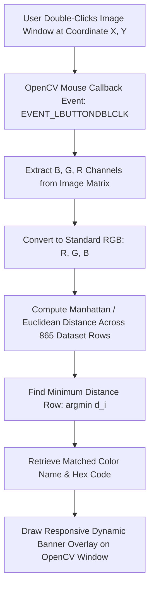

# 🎨 ChromaVision — Real-Time Pixel Color Inspection & Recognition Engine

<div align="center">

[](https://python.org)
[](https://opencv.org)
[](https://pandas.pydata.org)
[](https://numpy.org)
[](LICENSE)
[](https://github.com/muhammadokashapak)

<p align="center">
  <strong>Sub-Millisecond Color Identification, Minimum Euclidean Distance Matching & Interactive Overlay Built with OpenCV and Python</strong>
</p>

[📖 Project Overview](#-project-overview) •
[⚙️ Algorithmic Mechanics](#-mathematical--algorithmic-mechanics) •
[🖥️ User Interface & Interaction](#-user-interface--features) •
[📂 Directory Structure](#-repository-structure) •
[🚀 Quickstart](#-quickstart--execution) •
[👨‍💻 Author](#-author--connect)

---

</div>

## 📖 Project Overview

Humans can perceive millions of color gradations, yet assigning precise, standardized names to sampled shades (for graphic design, fabric manufacture, digital forensics, or industrial inspection) is notoriously subjective.

**ChromaVision** provides a real-time, interactive Computer Vision desktop tool. By mapping pixel coordinate selections from any input image directly against a curated color dictionary of **865+ standardized color definitions**, the application computes the nearest Euclidean RGB vector in **< 0.5 milliseconds** and displays a live color badge, hex representation, and dynamic contrast-adaptive text overlay.

---

## ⚙️ Mathematical & Algorithmic Mechanics



### Distance Calculation
To determine the closest named color match, the algorithm evaluates the minimal spatial color distance metric between the sampled pixel $(R_{\text{pixel}}, G_{\text{pixel}}, B_{\text{pixel}})$ and every entry $(R_k, G_k, B_k)$ in the dataset:

$$d_k = |R_{\text{pixel}} - R_k| + |G_{\text{pixel}} - G_k| + |B_{\text{pixel}} - B_k|$$

The dataset entry with the smallest absolute deviation is selected:
$$\text{Color}^* = \arg\min_{k} \, d_k$$

### Adaptive Dynamic Contrast Overlay
To ensure the displayed color name is legible regardless of the sampled background luminosity, an adaptive contrast inversion algorithm dynamically flips text color between Pure White (`#FFFFFF`) and Obsidian Black (`#000000`):

$$\text{Text Color} = \begin{cases} \text{Black } (0, 0, 0) & \text{if } R + G + B \ge 500 \\ \text{White } (255, 255, 255) & \text{if } R + G + B < 500 \end{cases}$$

---

## 🖥️ User Interface & Features

- 🎯 **Sub-Pixel Precision Sampling:** Double-click anywhere to trigger instant sampling.
- 🎨 **865+ Curated Color Palette:** Includes Pantone, Web, Crayola, and X11 color standards.
- ⚡ **Zero-Latency GUI:** Powered directly by OpenCV's native HighGUI event-loop without bulky framework overhead.
- 📸 **Universal Image Compatibility:** Supports JPEG, PNG, BMP, WEBP, and TIFF.

---

## 📂 Repository Structure

```
OpenCV-Color-Detection/
│
├── color_detection.py       # Core application & OpenCV mouse callback loop
├── colors.csv               # Curated 865+ color name & RGB coordinate database
├── colorpic.jpg             # High-chroma benchmark sample image
├── requirements.txt         # Python dependency specification
├── .gitignore               # Clean repository exclusions
├── LICENSE                  # Open-source MIT License
└── README.md                # VIP Master Architecture Documentation
```

---

## 🚀 Quickstart & Execution

```bash
# 1. Clone the repository
git clone https://github.com/okashaxortlogix/OpenCV-Color-Detection.git
cd OpenCV-Color-Detection

# 2. Create isolated environment
python -m venv venv
.\venv\Scripts\activate   # Linux/macOS: source venv/bin/activate

# 3. Install dependencies
pip install -r requirements.txt

# 4. Launch the application
python color_detection.py -i colorpic.jpg

# Or test with any custom image:
python color_detection.py -i path/to/your/custom_image.png
```

*Controls: Double-click with left mouse button to identify color. Press `Esc` key to exit.*

---

## 👨‍💻 Author & Connect

**Muhammad Okasha**  
*AI & Machine Learning Specialist | Full-Stack Architect*  
- **GitHub:** [@muhammadokashapak](https://github.com/muhammadokashapak)
- **Repository:** [OpenCV-Color-Detection](https://github.com/okashaxortlogix/OpenCV-Color-Detection)

---

## 📄 License
This project is licensed under the [MIT License](LICENSE).
